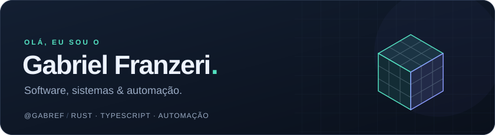
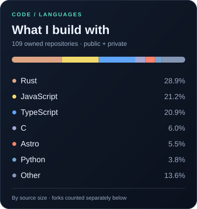
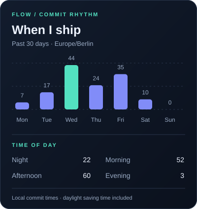
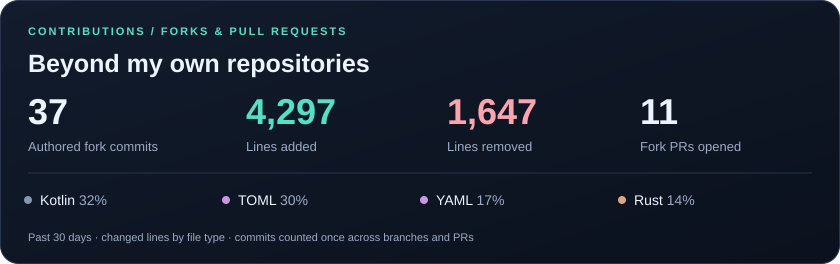

<p align="center">
  
</p>

<p align="center">
  <a href="https://gabudev.cloud">Website</a> &nbsp;·&nbsp;
  <a href="https://www.linkedin.com/in/gabriel-franzeri-840196211/">LinkedIn</a> &nbsp;·&nbsp;
  <a href="https://t.me/gabref">Telegram</a> &nbsp;·&nbsp;
  <a href="mailto:gabrielfranzer@gmail.com">Email</a> &nbsp;·&nbsp;
  <a href="https://instagram.com/gabre___/">Instagram</a>
</p>

<p align="center">
  Estudando as tecnologias por trás da automação comercial.<br>
  Fora do código, resolvo o cubo mágico.
</p>

<p align="center">
   &nbsp;
   &nbsp;
   &nbsp;
   &nbsp;
   &nbsp;
   &nbsp;
   &nbsp;
   &nbsp;
  
</p>

<!--START_SECTION:github-stats-->
## 📊 GitHub activity

<p align="center">
  
</p>
<p align="center">
  
  
</p>

<p align="center">
  
</p>

<details>
<summary>Explore the numbers</summary>

| Activity | Past 7 days | Past 30 days |
| :--- | ---: | ---: |
| Commits | 31 | 130 |
| Active days | 6 | 21 |
| Repositories | 5 | 13 |
| Lines added | 33,962 | 109,992 |
| Lines removed | 7,851 | 42,081 |

**Also in the past 30 days:** Pull requests opened: 15 · Reviews submitted: 0 · Issues opened: 1

**Commit activity by day** · past 30 days · Europe/Berlin

```text
Monday                        7  █░░░░░░░░░░░░░░░░░░░   5.38%
Tuesday                      17  ███░░░░░░░░░░░░░░░░░  13.08%
Wednesday                    44  ███████░░░░░░░░░░░░░  33.85%
Thursday                     22  ███░░░░░░░░░░░░░░░░░  16.92%
Friday                       30  █████░░░░░░░░░░░░░░░  23.08%
Saturday                     10  ██░░░░░░░░░░░░░░░░░░   7.69%
Sunday                        0  ░░░░░░░░░░░░░░░░░░░░   0.00%
```

**Commit activity by time of day** · past 30 days

```text
Night (00:00–05:59)           22  ███░░░░░░░░░░░░░░░░░  16.92%
Morning (06:00–11:59)         50  ████████░░░░░░░░░░░░  38.46%
Afternoon (12:00–17:59)       55  ████████░░░░░░░░░░░░  42.31%
Evening (18:00–23:59)          3  ░░░░░░░░░░░░░░░░░░░░   2.31%
```

**Languages across 108 repositories** · public + private · source size in bytes

```text
Rust                   7,735,604  ███████░░░░░░░░░░░░░  35.05%
TypeScript             4,760,989  ████░░░░░░░░░░░░░░░░  21.57%
JavaScript             2,715,172  ██░░░░░░░░░░░░░░░░░░  12.30%
C                      1,681,082  ██░░░░░░░░░░░░░░░░░░   7.62%
Astro                  1,553,143  █░░░░░░░░░░░░░░░░░░░   7.04%
HTML                     734,014  █░░░░░░░░░░░░░░░░░░░   3.33%
CSS                      547,494  ░░░░░░░░░░░░░░░░░░░░   2.48%
Go                       435,961  ░░░░░░░░░░░░░░░░░░░░   1.98%
Other                  1,905,953  ██░░░░░░░░░░░░░░░░░░   8.64%
```

**Repository coverage:** 51 public + 57 private owned, non-fork repositories.

**Private contributions reported by GitHub:** 97 (includes contribution types beyond commits; not added to the commit total).

**Forks & pull requests · past 30 days**

| Authored fork commits | Lines added | Lines removed | PRs opened involving forks |
| ---: | ---: | ---: | ---: |
| 37 | 4,297 | 1,647 | 11 |

**Languages in fork contributions** · changed lines by file type

```text
Kotlin                    1,902  ██████░░░░░░░░░░░░░░  32.00%
TOML                      1,811  ██████░░░░░░░░░░░░░░  30.47%
YAML                      1,010  ███░░░░░░░░░░░░░░░░░  16.99%
Rust                        860  ███░░░░░░░░░░░░░░░░░  14.47%
Documentation               340  █░░░░░░░░░░░░░░░░░░░   5.72%
JavaScript                    6  ░░░░░░░░░░░░░░░░░░░░   0.10%
Swift                         6  ░░░░░░░░░░░░░░░░░░░░   0.10%
XML                           5  ░░░░░░░░░░░░░░░░░░░░   0.08%
JSON                          4  ░░░░░░░░░░░░░░░░░░░░   0.07%
```

</details>

<details>
<summary>About these stats</summary>

Activity covers my authored commits on default branches, owned fork branches, and pull requests I opened, in repositories accessible to the automation. Merge commits and duplicate commit hashes are excluded. Private activity is aggregated without repository names. Line counts describe commit diffs, including generated files. Private repository discovery includes accessible collaborations. Languages cover my public and private, owned, non-fork repositories.

</details>

Updated on 2026-11-12 UTC · Generated by [my own automation](.github/readme-stats)
<!--END_SECTION:github-stats-->
