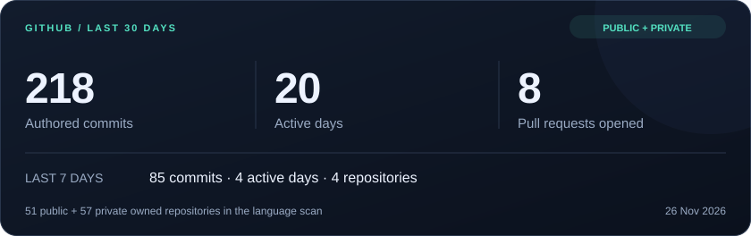
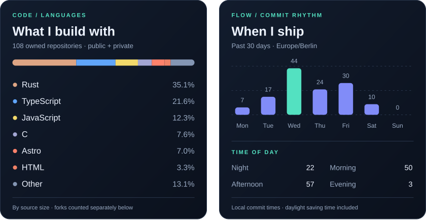
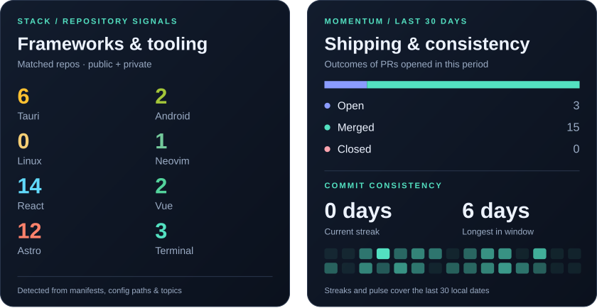

<p align="center">
  
</p>

<p align="center">
  <a href="https://gabudev.cloud">Website</a> &nbsp;·&nbsp;
  <a href="https://www.linkedin.com/in/gabriel-franzeri-840196211/">LinkedIn</a> &nbsp;·&nbsp;
  <a href="https://t.me/gabref">Telegram</a> &nbsp;·&nbsp;
  <a href="mailto:gabrielfranzer@gmail.com">Email</a> &nbsp;·&nbsp;
  <a href="https://instagram.com/gabre___/">Instagram</a>
</p>

<p align="center">
  Building tools with Rust, Tauri, and TypeScript.<br>
  At home with Linux, Neovim, and the terminal.<br>
  Exploring commercial automation. Solving Rubik's cubes away from the keyboard.
</p>

<p align="center">
   &nbsp;
   &nbsp;
   &nbsp;
   &nbsp;
   &nbsp;
   &nbsp;
   &nbsp;
   &nbsp;
   &nbsp;
   &nbsp;
   &nbsp;
   &nbsp;
   &nbsp;
  
</p>

<!--START_SECTION:github-stats-->
## 📊 GitHub activity

<p align="center">
  <picture>
    <source media="(max-width: 1199px)" srcset="assets/stats/activity-compact.svg">
    
  </picture>
</p>

<p align="center">
  <picture>
    <source media="(max-width: 1199px)" srcset="assets/stats/languages-rhythm-stacked.svg">
    
  </picture>
</p>

<p align="center">
  <picture>
    <source media="(max-width: 1199px)" srcset="assets/stats/forks-compact.svg">
    
  </picture>
</p>

<p align="center">
  <picture>
    <source media="(max-width: 1199px)" srcset="assets/stats/stack-shipping-stacked.svg">
    
  </picture>
</p>

<details>
<summary>Explore the numbers</summary>

| Activity | Past 7 days | Past 30 days |
| :--- | ---: | ---: |
| Commits | 39 | 145 |
| Active days | 4 | 22 |
| Repositories | 3 | 14 |
| Lines added | 8,678 | 105,816 |
| Lines removed | 1,911 | 35,404 |

**Also in the past 30 days:** Pull requests opened: 18 · Reviews submitted: 0 · Issues opened: 1

**Commit activity by day** · past 30 days · Europe/Berlin

```text
Monday                        8  █░░░░░░░░░░░░░░░░░░░   5.52%
Tuesday                      47  ██████░░░░░░░░░░░░░░  32.41%
Wednesday                    30  ████░░░░░░░░░░░░░░░░  20.69%
Thursday                     14  ██░░░░░░░░░░░░░░░░░░   9.66%
Friday                       34  █████░░░░░░░░░░░░░░░  23.45%
Saturday                     12  ██░░░░░░░░░░░░░░░░░░   8.28%
Sunday                        0  ░░░░░░░░░░░░░░░░░░░░   0.00%
```

**Commit activity by time of day** · past 30 days

```text
Night (00:00–05:59)           22  ███░░░░░░░░░░░░░░░░░  15.17%
Morning (06:00–11:59)         54  ███████░░░░░░░░░░░░░  37.24%
Afternoon (12:00–17:59)       63  █████████░░░░░░░░░░░  43.45%
Evening (18:00–23:59)          6  █░░░░░░░░░░░░░░░░░░░   4.14%
```

**Languages across 108 repositories** · public + private · source size in bytes

```text
Rust                   7,735,604  ███████░░░░░░░░░░░░░  35.05%
TypeScript             4,760,989  ████░░░░░░░░░░░░░░░░  21.57%
JavaScript             2,715,172  ██░░░░░░░░░░░░░░░░░░  12.30%
C                      1,681,082  ██░░░░░░░░░░░░░░░░░░   7.62%
Astro                  1,553,143  █░░░░░░░░░░░░░░░░░░░   7.04%
HTML                     734,014  █░░░░░░░░░░░░░░░░░░░   3.33%
CSS                      547,494  ░░░░░░░░░░░░░░░░░░░░   2.48%
Go                       435,961  ░░░░░░░░░░░░░░░░░░░░   1.98%
Other                  1,905,953  ██░░░░░░░░░░░░░░░░░░   8.64%
```

**Repository coverage:** 51 public + 57 private owned, non-fork repositories.

**Private contributions reported by GitHub:** 93 (includes contribution types beyond commits; not added to the commit total).

**PR outcomes** · for PRs opened in the past 30 days

| Open | Merged | Closed without merge |
| ---: | ---: | ---: |
| 3 | 15 | 0 |

**Commit streaks within the last 30 local dates:** current 0 days · longest 6 days.

**Framework & tooling signals** · owned non-fork repositories; a repository can match multiple tools

| Tool | Matched repositories |
| :--- | ---: |
| Tauri | 6 |
| Android | 2 |
| Linux | 0 |
| Neovim | 1 |
| React | 14 |
| Vue | 2 |
| Astro | 12 |
| Terminal | 3 |

**Forks & pull requests · past 30 days**

| Authored fork commits | Lines added | Lines removed | PRs opened involving forks |
| ---: | ---: | ---: | ---: |
| 66 | 7,154 | 3,254 | 15 |

**Languages in fork contributions** · changed lines by file type

```text
TOML                      2,633  █████░░░░░░░░░░░░░░░  25.30%
Rust                      2,551  █████░░░░░░░░░░░░░░░  24.51%
YAML                      2,252  ████░░░░░░░░░░░░░░░░  21.64%
Swift                     1,425  ███░░░░░░░░░░░░░░░░░  13.69%
Kotlin                      749  █░░░░░░░░░░░░░░░░░░░   7.20%
Documentation               571  █░░░░░░░░░░░░░░░░░░░   5.49%
Python                      177  ░░░░░░░░░░░░░░░░░░░░   1.70%
JSON                         26  ░░░░░░░░░░░░░░░░░░░░   0.25%
XML                          18  ░░░░░░░░░░░░░░░░░░░░   0.17%
JavaScript                    6  ░░░░░░░░░░░░░░░░░░░░   0.06%
```

</details>

<details>
<summary>About these stats</summary>

Activity covers my authored commits on default branches, owned fork branches, and pull requests I opened, in repositories accessible to the automation. Merge commits and duplicate commit hashes are excluded. Private activity is aggregated without repository names. Line counts describe commit diffs, including generated files. Private repository discovery includes accessible collaborations. Languages cover my public and private, owned, non-fork repositories.

</details>

Updated on 2026-11-20 UTC · Generated by [my own automation](.github/readme-stats)
<!--END_SECTION:github-stats-->
